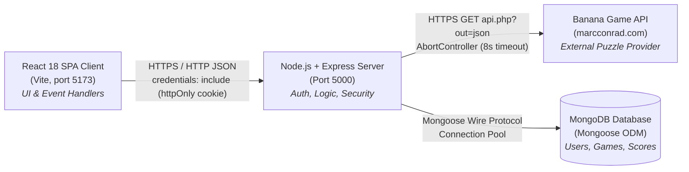
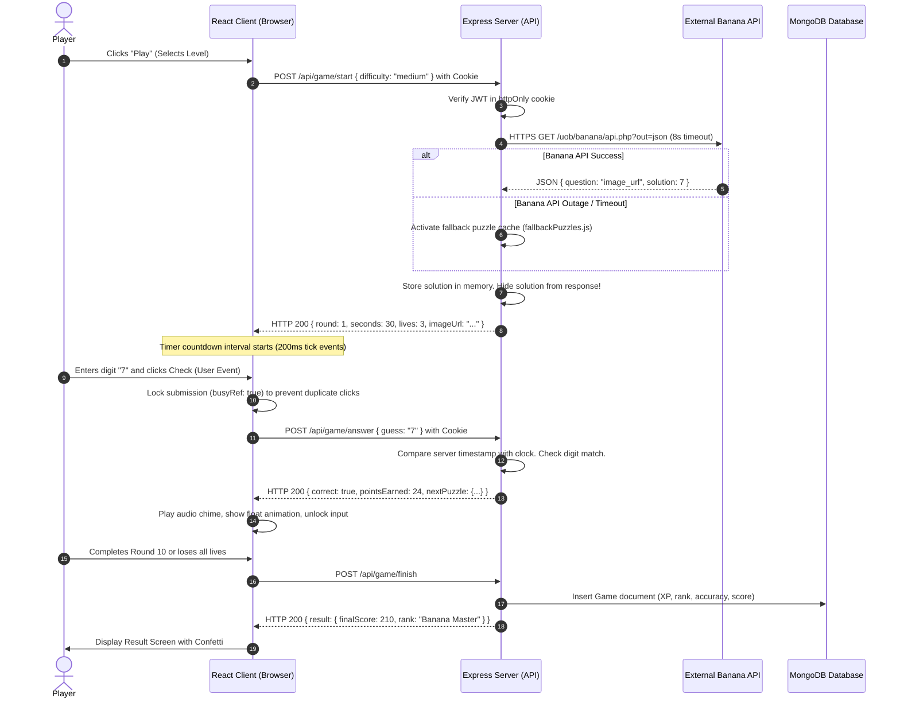

<!--
Purpose: Comprehensive architectural specification, communication flows, and critical evaluation of design alternatives.
Theme: All Four Themes
-->

# System Architecture & Critical Evaluation

Banana Quiz Challenge is built on a four-tier architecture separating presentation, business logic, persistence, and external service integration.

---

## 1. Communication Protocols & Data Contracts

| Boundary | Protocol | Format | Security & Reliability Controls |
| --- | --- | --- | --- |
| **Client &rarr; Server** | HTTP/1.1 (JSON) on Port 5000 | Request body JSON (`limit: 100kb`) | CORS restricted to `CLIENT_ORIGIN`; `credentials: true`; `httpOnly` cookie; Rate limiting (429); CSRF Origin verification. |
| **Server &rarr; Client** | HTTP/1.1 (JSON) | `{ success: boolean, ... }` | HTTP status codes (200, 201, 400, 401, 403, 404, 409, 429, 500, 502, 504); `Set-Cookie` with `HttpOnly; SameSite=Lax`. |
| **Server &rarr; Banana API** | HTTPS GET | URL query `?out=json` | AbortController 8s timeout; Custom parser handling `text/html` quirk; Automatic fallback cache on outage. |
| **Server &rarr; MongoDB** | MongoDB Wire Protocol | BSON Documents | Mongoose schema validation; Unique indexes on email/username; Bcrypt salt hash; `passwordHash` hidden by default. |

---

## 2. End-to-End Game Sequence Flow

---

## 3. Critical Evaluation & Architectural Alternatives (70+ Criteria)

### A. Version Control Architecture
- **Implemented Design**: Feature branching (`feature/api-integration`, `feature/authentication`, `feature/event-system`, `feature/70-plus-hardening`) merged into `main` using explicit non-fast-forward merge commits (`git merge --no-ff`) and tagged releases (`v1.0`).
- **Advantages**: Keeps `main` permanently deployable; isolates unstable experimental code; provides auditable Git history graph.
- **Limitations**: In a single-developer scenario, branch switching adds slight overhead.
- **Alternative Evaluated**: Trunk-Based Development (all commits directly to `main`). While simpler for solo work, it risks breaking production code and loses the auditable merge boundaries required for enterprise teamwork.
- **Enterprise Team Improvement**: In an enterprise environment, we would integrate GitHub Pull Requests (PRs), branch protection rules requiring at least one peer code review, and automated CI/CD pipelines (GitHub Actions) running linting and automated unit tests before merge.

### B. Event-Driven Architecture
- **Implemented Design**: React unidirectional event flow (`User Events` & `Temporal Events` &rarr; Event Handlers &rarr; State Dispatch `setState` &rarr; Virtual DOM reconciliation).
- **Advantages**: Immediate user feedback, zero page flicker, fine-grained timer animation, robust race condition prevention using `useRef` locks.
- **Limitations**: Complex state synchronization if multiple asynchronous events complete out of order.
- **Alternative Evaluated**: Traditional Multi-Page Request-Response (e.g. Server-Rendered HTML forms). Submitting a form would force full page reload, dropping audio continuity and making timed round countdowns impossible.
- **Alternative Evaluated**: WebSockets (Socket.IO). While WebSockets provide bidirectional real-time push, they introduce stateful TCP connection overhead. For a turn-based missing-digit quiz, standard REST calls paired with client-side interval events are significantly more resource-efficient.

### C. Interoperability Architecture
- **Implemented Design**: Express backend acts as an API gateway / reverse proxy between React client and Marc Conrad's external Banana API, augmented with an automatic fallback cache (`fallbackPuzzles.js`).
- **Advantages**:
  1. *Zero Client Exposure*: The browser never sees the `solution` digit, preventing inspection cheating.
  2. *CORS Bypass*: Bypasses the lack of client-side CORS headers on `marcconrad.com`.
  3. *Fault Tolerance*: Graceful degradation ensures the application never crashes if the upstream provider goes offline.
- **Limitations**: Server memory holds active puzzle solutions in a `Map`. A server restart clears active rounds in progress.
- **Alternative Evaluated**: Direct Client-Side Fetch. Completely unviable because the Banana API sends the plain answer in JSON and does not send CORS allow headers to localhost.
- **Alternative Evaluated**: Standalone Self-Hosted Image Generation Service. Building a local math equation generator using Node Canvas would provide 100% autonomy, but would forfeit the enterprise objective of integrating heterogeneous web services.

### D. Virtual Identity & Security Architecture
- **Implemented Design**: Bcrypt password hashing (10 salt rounds) + JSON Web Tokens (JWT) stored in cryptographically signed `httpOnly` cookies with `SameSite=Lax` and custom rate limiting (5 attempts/15 min).
- **Advantages**:
  1. *XSS Immunity*: Storing JWT in `httpOnly` cookies makes tokens completely unreadable to client-side scripts, unlike `localStorage`.
  2. *Brute-Force Defense*: Rate limiting halts automated credential stuffing.
  3. *Stateless Scalability*: JWT signature verification requires no database lookup on read routes.
- **Limitations**: JWT cannot be revoked immediately before its 2-hour expiry without introducing a shared blacklist.
- **Alternative Evaluated**: Server-Side Sessions with Redis (`express-session`). Sessions allow immediate revocation on logout, but introduce stateful database dependency on every request.
- **Alternative Evaluated**: OAuth 2.0 / OpenID Connect (e.g., Google or GitHub Login). Offloads credential management to a trusted identity provider, but introduces third-party dependency for login.
