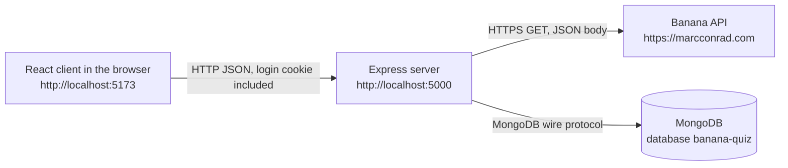
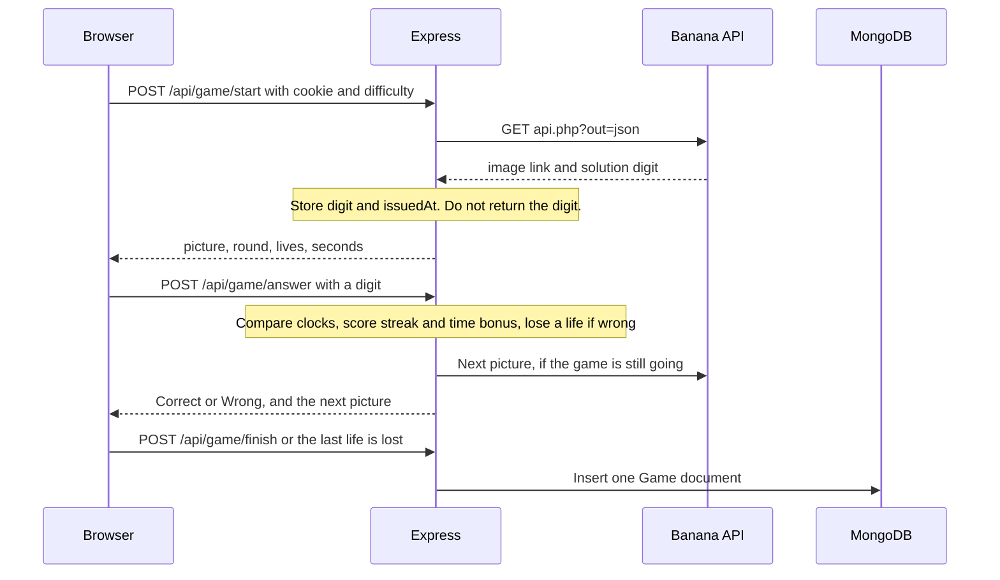
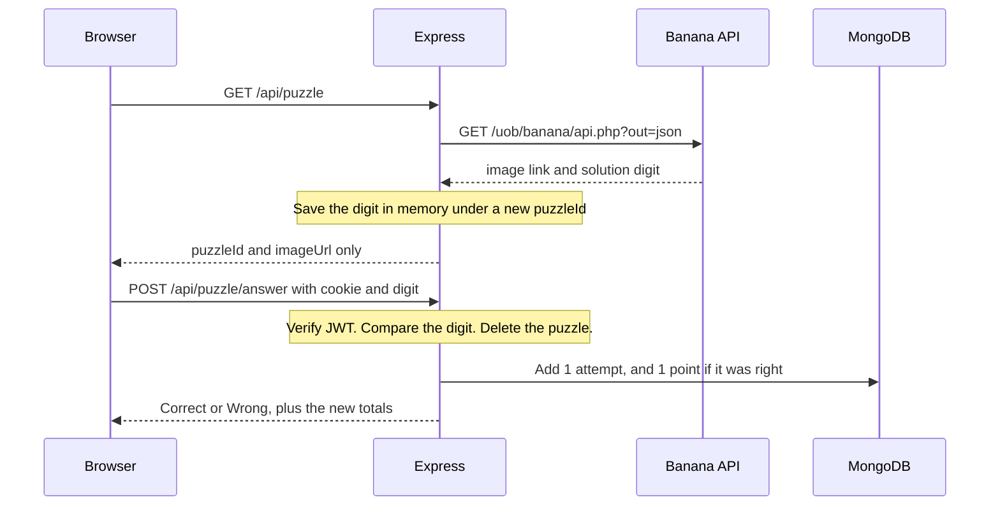

<!--
Purpose: Shows the four parts of the system and how a guess travels between them.
Theme: All four themes
Portions generated with AI assistance (Cursor) - reviewed and understood by the author.
-->

# Architecture

Banana Quiz Challenge is four parts. The browser never calls the Banana API. Only the Express server does.

## How each part communicates

| From | To | Protocol | Format |
| --- | --- | --- | --- |
| React | Express | HTTP on port 5000 | JSON. The browser sends the `token` cookie because `fetch` uses `credentials: 'include'`. |
| Express | React | HTTP response | JSON `{ success, ... }` or `{ success: false, message }`. Login also sends a `Set-Cookie` header. |
| Express | Banana API | HTTPS GET | The body is JSON (`question`, `solution`) even though the content type is `text/html`. See `docs/API_EVIDENCE.md`. |
| Express | MongoDB | MongoDB protocol | User documents, finished Game documents, and older Score totals, through Mongoose. |

CORS is required because the page is on port 5173 and the API is on port 5000. Those are different origins. The server allows only `CLIENT_ORIGIN` and sets `credentials: true`. A wildcard origin cannot be used together with cookies.

## A 10-round game

The active game lives in memory on the server (`server/services/gameStore.js`). It holds the digit, the time the picture was issued, the lives, and the score. The browser is sent the picture and `issuedAt`. It draws a countdown from that time. When the guess arrives, the server measures the gap with its own clock and allows 1.5 extra seconds for a slow network. A late guess is rejected. A timeout or a wrong digit removes a life.

Difficulty is not sent to the Banana API. `server/config/gameModes.js` chooses the seconds, lives, hints, and base points. The API is only asked for the next picture.

When lives hit 0, or round 10 is answered, or the player quits, the server writes one `Game` document and deletes the in-memory session.

## What happens when a player guesses

## Where each theme sits

| Theme | Where to look |
| --- | --- |
| Version control | `.gitignore`, `docs/GIT_WORKFLOW.md`, `docs/CHANGELOG.md` |
| Interoperability | `server/services/bananaService.js`, `server/services/puzzleStore.js`, `server/controllers/puzzleController.js` |
| Event-driven programming | `client/src/pages/PuzzlePage.jsx` |
| Virtual identity | `server/controllers/authController.js`, `server/middleware/auth.js`, `client/src/context/AuthContext.jsx` |

## A limit of this design

The correct digit is stored in a `Map` inside the Node process. Restarting the server forgets puzzles that have not been answered yet. Two copies of the server would not share that list. Users and scores are in MongoDB, so those survive a restart. A shared store such as Redis would be the next step if more than one server was running.
